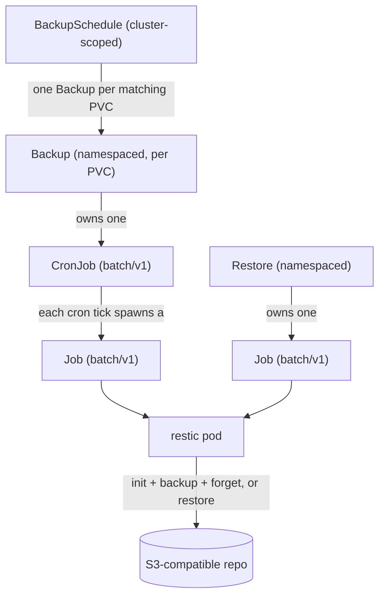

<div align="center">


<h1>secchio</h1>

K8s Backup & Restore operator
</div>

## rationale

```
Should I build my own backup operator for my cluster ?
No. Use an existing operator (e.g. Velero).
```

I was, in fact, not happy with velero, or any other backup solutions.
I want to backup pvcs (not the whole cluster because I'm using gitops principles) using restic somewhere (like a s3 bucket). And sometimes I want to restore _ONLY_ a pvc because an upgrade failed or whatever. Turns out it's not that simple. 

## what does it do

secchio backs up PersistentVolumeClaims on a cron schedule into S3-compatible
storage using [restic](https://restic.net/), and restores them on demand. 
It is built on [kopf](https://kopf.readthedocs.io/) for talking with k8s, 
and ships a small web UI from where you can view backups and restores.
You can trigger one-shot backups and pvc restore from it.


When starting the project, I had a few things in mind:
- Resilience: the operator should only orchestrates native Kubernetes objects. Meaning if the operator is down, existing backups are still being done
- Standing on the shoulders of giants: I'm not rolling my own backup mecanism, I'm simply wrapping trusted tech.
- Explore CRDs & operator: I wanted to learn more on how operators work, and how we interact/work with your own CRDs.
- A simple UI to create on demand backup/restore, rather than creating a random yaml file that will be used one shot.

## Architecture

Three custom resources (`secchio.cocointhe.cloud/v1alpha1`) describe backup/restore intent; the
operator turns them into native workloads that kubernetes can execute.



A `BackupSchedule` matches PVCs by label and manages one `Backup` per match.
Each `Backup` owns a CronJob (namespace = the PVC's namespace). Each `Restore`
owns a one-off Job. The CronJob/Job pods are the only things that touch restic and
the S3 repository.

### Quickstart

Deploy the operator
```
helm install secchio-operator oci://ghcr.io/k0rventen/secchio --create-namespace --namespace secchio-system --version 0.7.1
```

The operator should start, and you can access the ui with a port-forward:

```
kubectl port-forward -n secchio-system svc/secchio-ui 8000:8000
```
open http://localhost:8000


You can then create a BackupSchedule object. Have a look at tests/test-manifest.yaml as an example.

### Local development with Tilt

```bash
tilt up --stream
```

## Inspiration and credits

This repo is inspired by other backup systems like velero, k8up. Thanks to this repo https://github.com/alubbock/backup-pvc-examples/tree/main/aws-s3 for triggering the 'well it's not that complicated is it ??' moment.

I'm using kopf for talking to k8s, restic for handling backups, fastapi for the interface.


## License

MIT.
