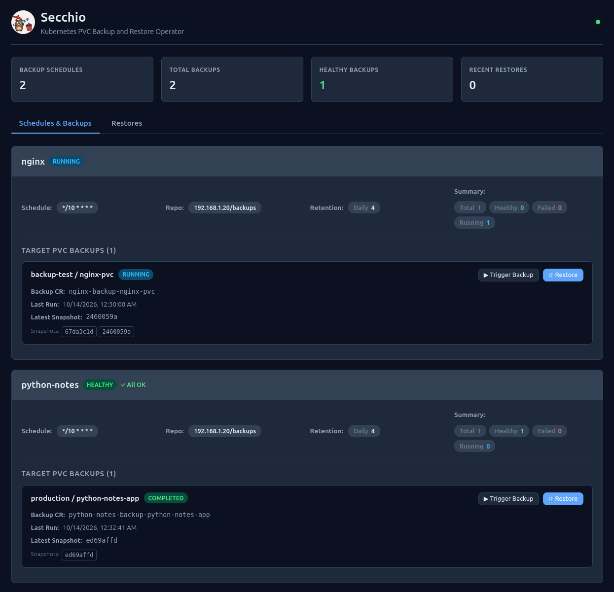
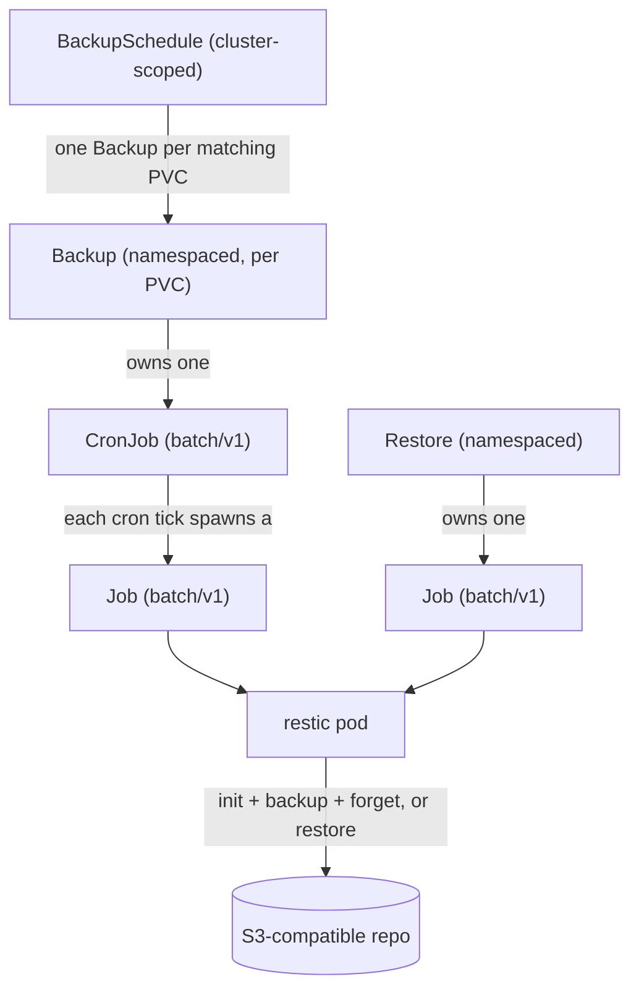

<div align="center">


<h1>secchio</h1>

K8s Backup & Restore operator
</div>

## rationale

```
Should I build my own backup operator for my cluster ?
No. Use an existing operator (e.g. Velero).
```

I was, in fact, not happy with velero, or any other backup solutions.
I want to backup pvcs (not the whole cluster because I'm using gitops principles) using restic somewhere (like a s3 bucket). And sometimes I want to restore _ONLY_ a pvc because an upgrade failed or whatever. Turns out it's not that simple. 

## what does it do

secchio backs up PersistentVolumeClaims on a cron schedule into S3-compatible
storage using [restic](https://restic.net/), and restores them on demand. 
It is built on [kopf](https://kopf.readthedocs.io/) for talking with k8s, 
and ships a small web UI from where you can view backups and restores.
You can trigger one-shot backups and pvc restore from it.

- **Core idea:** the operator only orchestrates native Kubernetes objects. Meaning ff the operator is down, existing backups are still being done through their respective cronjobs.
- **Storage:** S3-compatible (used by restic)
- **CRDs:** `BackupSchedule` (cluster-scoped) selects PVCs by label; `Backup`
  (namespaced, one per PVC) drives a CronJob; `Restore` (namespaced) runs a one-off Job.

## Contents

- [Architecture](#architecture)
- [Technical choices](#technical-choices)
- [Data model](#data-model)
- [Components](#components)
- [Quickstart](#quickstart)
- [Custom resources](#custom-resources)
- [Configuration](#configuration)
- [Development](#development)

## Architecture

Three custom resources (`secchio.cocointhe.cloud/v1alpha1`) describe intent; the
operator turns them into native workloads. 



A `BackupSchedule` matches PVCs by label and manages one `Backup` per match.
Each `Backup` owns a CronJob (namespace = the PVC's namespace). Each `Restore`
owns a one-off Job. The CronJob/Job pods are the only things that touch restic and
the S3 repository.

### Local development with Tilt

```bash
tilt up
```

This deploys the operator from `charts/secchio/` using the tilt values.

## License

MIT.
