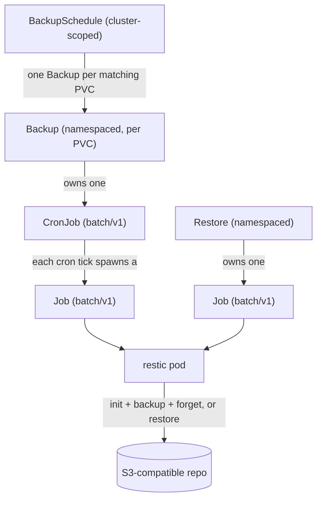

<div align="center">


<h1>secchio</h1>

K8s Backup & Restore operator
</div>

## rationale

```
Should I build my own backup operator for my cluster ?
No. Use an existing operator (e.g. Velero).
```

I was, in fact, not happy with velero, or any other backup solutions.
I want to backup pvcs (not the whole cluster because I'm using gitops principles) using restic somewhere (like a s3 bucket). And sometimes I want to restore _ONLY_ a pvc because an upgrade failed or whatever. Turns out it's not that simple. 

## what does it do

secchio backs up PersistentVolumeClaims on a cron schedule into S3-compatible
storage using [restic](https://restic.net/), and restores them on demand. 
It is built on [kopf](https://kopf.readthedocs.io/) for talking with k8s, 
and ships a small web UI from where you can view/trigger backups and restores.


When starting the project, I had a few things in mind:
- Resilience: the operator should only orchestrates native Kubernetes objects. Meaning if the operator is down, existing backups are still being done
- Standing on the shoulders of giants: I'm not rolling my own backup mecanism, I'd rather be wrapping trusted tech.
- Explore CRDs & operator: I wanted to learn more on how operators work, and how we interact/work with our own CRDs.
- A simple UI to create on demand backup/restore, rather than creating a random yaml file that will be used one shot.

## Architecture

Three custom resources (`secchio.cocointhe.cloud/v1alpha1`) describe backup/restore intent; the
operator turns them into native workloads that kubernetes can execute.



A `BackupSchedule` matches PVCs by label and manages one `Backup` per match.
Each `Backup` owns a CronJob (namespace = the PVC's namespace). Each `Restore`
owns a one-off Job. The CronJob/Job pods are the only things that touch restic and
the S3 repository.

### Quickstart

Deploy the operator
```sh
helm install secchio-operator oci://ghcr.io/k0rventen/secchio --create-namespace --namespace secchio-system --version 0.8.0
```

The operator should start, and you can access the ui with a port-forward:

```sh
kubectl port-forward -n secchio-system svc/secchio-ui 8000:8000
```
then open http://localhost:8000. The chart does not provide a way to expose natively the UI through a Ingress due to the nature of the actions available. Adding auth is out of scope for now. I recommend either a port forward or using a solution like warpgate for securing access.


You can then create a BackupSchedule object:
```yaml
apiVersion: v1
kind: Secret
metadata:
  name: restic-s3-secret
  namespace: production
type: Opaque
stringData:
  RESTIC_PASSWORD: "changeme-restic-password"
  AWS_ACCESS_KEY_ID: "changeme-access-key-id"
  AWS_SECRET_ACCESS_KEY: "changeme-secret-access-key"
---
apiVersion: secchio.cocointhe.cloud/v1alpha1
kind: BackupSchedule
metadata:
  name: python-notes
spec:
  pvc:
    selector:
      app: python-notes-app
  schedule: "*/10 * * * *"
  repo:
    endpoint: 192.168.1.20/backups
    secretName: restic-s3-secret
    insecureTLS: true
  retention:
    keepDaily: 7
    keepWeekly: 4
    keepMonthly: 3
```

Have a look at tests/test-manifests.yaml for a full example.

### Local development with Tilt

```bash
tilt up --stream
```
The secchio UI will be available on http://localhost:8002

## Inspiration and credits

The name secchio means 'bucket' in italian.

The logo is supposed to look like the restic gopher, throwing (volumes) cylinders into a (s3) bucket

This repo is inspired by other backup systems like [velero](https://velero.io/), [k8up](https://k8up.io/). Thanks to [this repo](https://github.com/alubbock/backup-pvc-examples/tree/main/aws-s3) for triggering the 'well it's not that complicated is it ??' moment. (Turns out, was complicated.)

I'm using [kopf](https://kopf.dev/) for talking to k8s, [restic](https://restic.net/) for handling backups, [fastapi](https://fastapi.tiangolo.com/) for the interface.

Development was aided by AI: Deepseek v4.1 Flash for the filler code and tests generation. Local gemma4 12B for simpler fixes. 

## License

MIT.
