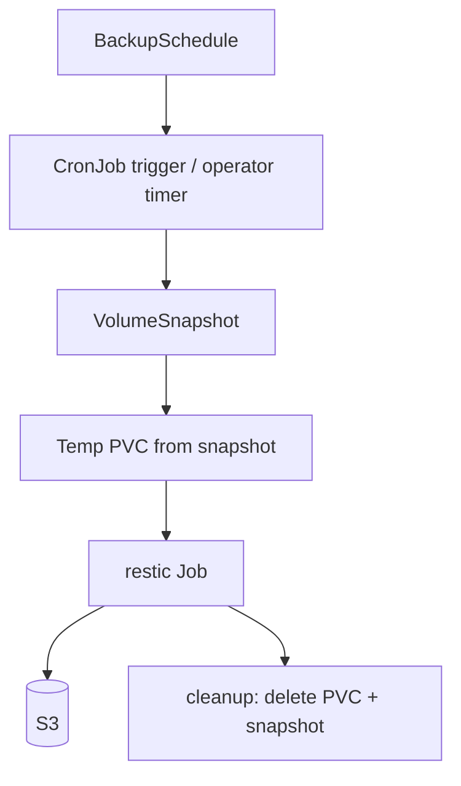

# secchio — Audit & Roadmap

**Last updated:** 2026-11-07  
**Supersedes:** `report.md` (full audit, 2026-10-31) and `todo.md` (prior backlog). Both were merged into this document and removed.  
**Scope:** `src/`, `charts/secchio/`, `restic-pod/`, `tests/`, CI workflows, docs.  
**Method:** static review of every source file, CRD, chart template, image entrypoint, test, and CI workflow, re-verified against the current tree. `pytest tests/` passes (57 tests at the time of this update).

> **Verification note:** The canonical gate is the Dockerfile's `tests` target, which runs `make -f tests/Makefile verify` (lint, typecheck, pyright, shellcheck, pytest) inside the build image:
>
> ```sh
> docker buildx build -t secchio-tests --target tests .
> ```
>
> This is what CI uses (`.github/workflows/pr-test.yaml`). For faster local iteration, run the Makefile stages through `uv` (`make -f tests/Makefile lint`, `typecheck`, `test`, etc.). In a sandbox without `~/.cache/uv` or network access, run `.venv/bin/python -m pytest tests/`, `.venv/bin/ruff check src/ tests/`, and `.venv/bin/mypy src/` directly.

## How to read this

**Status**

| Status | Meaning |
| --- | --- |
| **Open** | Not addressed. |
| **Partial** | A mitigation landed; the root cause remains. |
| **Fixed** | Verified in the current tree. |
| **Obsolete** | No longer applies (code/CRD removed or design changed). |

**Priority**

| Priority | Meaning |
| --- | --- |
| **P0** | Security-critical or data-loss risk — address before wider exposure. |
| **P1** | Correctness bug — wrong behavior in normal operation. |
| **P2** | Hardening / reliability — reduces blast radius or flakiness. |
| **P3** | Code quality, tooling, docs. |
| **P4** | Future feature / architecture. |

---

## Executive summary

The codebase is small, readable, and clean on dead code. The main risks are **operational and security gaps around the destructive capabilities** the operator exposes, plus a few **status/resilience** gaps.

### What changed since the 2026-10-31 audit

| Item | Status | Notes |
| --- | --- | --- |
| 1.5 Chart namespace lifecycle | **Fixed** | `charts/secchio/templates/ns.yaml` was removed; the quickstart uses `--create-namespace`. |
| 2.2 Event-only status / short TTL | **Partial** | `resync_schedule()` is called from the 60s `check_schedules` timer (`src/status.py`, `src/handlers.py`); `JOB_TTL_SECONDS` was raised 300 → 900s. **Restores still have no resync.** |
| 2.3 Snapshots lost / last-backup overwritten | **Partial** | `_merge_entry()` preserves existing snapshots when a Job reports none. `last_backup_time` is still overwritten on Running/Failed. |
| 3.4 Status patched even when unchanged | **Partial** | `_patch_schedule_entry` skips an unchanged status; `reconcile_schedule_status` still always patches, and `on_job` still reacts to non-terminal events. |
| 4.1 `docs/` empty and gitignored | **Partial** | `docs/` now contains `icon.svg`, `ui.png`, and `update.py`, but is still gitignored, so references are still broken in a fresh clone. |
| 4.2 Chart README stale | **Partial** | The migration section was updated; the configuration table still says `v0.7.2` while `values.yaml` is `v0.10.1`. |
| 4.3 `AGENTS.md` stale | **Fixed** | Updated alongside this document. |
| 4.4 `todo.md` stale | **Fixed** | Merged into this document. |
| 4.5 Gitea workflow sub-item | **Obsolete** | `.gitea/workflows/` was removed; the GitHub workflows remain. The other CI gaps are P3-3. |
| 4.10 Regex fallback | **Fixed** | The unreachable `snapshot ... saved` fallback and its `re` import were removed from `src/restic.py`. The explicit `delete_restore` remains (see P3-8). |

### Top open risks

1. **Committed credentials** in `tests/test-manifests.yaml` (P0-1).
2. **Unauthenticated destructive UI/API** backed by cluster-wide RBAC (P0-2).
3. **Restore target/source are not validated** — arbitrary PVC overwrite/read (P0-3).
4. **Restores are create-only and their status is still event-only** (P1-1, P1-2).
5. **`lastBackupTime` reports failed/running attempts as completed backups** (P1-3).

---

## 1. P0 — Security-critical

### P0-1 Committed credentials in `tests/test-manifests.yaml`

- **Where:** `tests/test-manifests.yaml` (the `restic-s3-secret` Secret).
- **Problem:** The Secret contains base64-encoded `AWS_ACCESS_KEY_ID`, `AWS_SECRET_ACCESS_KEY`, and `RESTIC_PASSWORD` values that look real, not placeholders.
- **Impact:** Anyone with repository access has the credentials; if the bucket is reachable, they can read/overwrite/delete backups. Git history retains them even after deletion.
- **Recommendation:** Rotate the credentials immediately; purge them from history (or treat the bucket as compromised); replace with obvious placeholders (`changeme-*`) or generate the Secret at test time. Add secret scanning (gitleaks/trufflehog) to CI.
- **Status:** **Open.**

### P0-2 Unauthenticated destructive UI/API with cluster-wide RBAC

- **Where:** `src/api.py`, `src/handlers.py` (`_serve_ui`), `charts/secchio/templates/rbac.yaml`, `charts/secchio/templates/deployment.yaml`.
- **Problem:** The FastAPI app has no authentication, authorization, CSRF protection, TLS, or rate limiting. It binds to `0.0.0.0:8000` and is exposed by the `secchio-ui` Service. The operator's ServiceAccount is bound to a ClusterRole with `*` on the secchio CRDs and cluster-wide create/update/delete on Jobs and CronJobs.
- **Impact:** Any pod in the cluster (or anyone with a port-forward) can create a `Restore` in any namespace (which mounts an arbitrary PVC read-write and runs `restic restore --delete`), delete any `Restore`, instantiate any CronJob as a one-off Job, and trigger backups for any schedule. This is effectively cluster-wide PVC overwrite/data destruction.
- **Recommendation:** Add authentication (OIDC/basic auth) and authorization (namespace allowlist, read-only by default). Split the UI into its own Deployment/ServiceAccount with namespace-scoped RBAC, or make the UI read-only and require `kubectl` for mutations. Add a NetworkPolicy, CSRF protection, `TrustedHostMiddleware`, disable FastAPI docs, and add rate limiting/audit logging.
- **Status:** **Open.**

### P0-3 Restore target and source are not validated

- **Where:** `src/api.py` (`CreateRestoreRequest`, `trigger_restore`), `src/reconcile.py` (`restore`), `src/workloads.py` (`create_restore_job`).
- **Problem:** `targetPVC` and `pvcName` are free-form strings. The operator mounts `targetPVC` read-write and runs `restic restore --delete` into it, derives the repo path from `pvcName`, and does not check that `pvcName` is selected by the referenced `BackupSchedule` or that `targetPVC` exists, is managed by secchio, or is not currently mounted.
- **Impact:** A user with UI/Restore-create access can overwrite any PVC in the namespace and restore a snapshot from any PVC in the same namespace into any target. The default target is the source PVC, so an in-place restore deletes files created after the snapshot.
- **Recommendation:** Validate in `reconcile.restore` (and ideally a validating webhook): `pvcName` must match the schedule's selector or appear in `status.backups`; `targetPVC` must exist and carry an explicit opt-in label/annotation, or be a newly created PVC; refuse in-place restores unless explicitly allowed; warn in the UI that `--delete` removes files not in the snapshot.
- **Status:** **Open.**

### P0-4 Manual backup trigger accepts any CronJob

- **Where:** `src/api.py` (`_trigger_backup_job`, `trigger_backup`).
- **Problem:** `_trigger_backup_job` reads a CronJob by name/namespace and creates a Job from its `jobTemplate`. It does not verify that the CronJob is secchio-managed (`app=secchio`, `secchio.cocointhe.cloud/schedule` label, or ownerReference to a `BackupSchedule`).
- **Impact:** Anyone with UI access can instantiate any CronJob in the cluster as a one-off Job, bypassing its schedule and concurrency policy. If the CronJob uses a privileged ServiceAccount or mounts sensitive volumes, the manual Job inherits that.
- **Recommendation:** Require `app=secchio` and a non-empty `secchio.cocointhe.cloud/schedule` label, and verify the CronJob's ownerReference points to a `BackupSchedule` in the same namespace. Reject otherwise with 403/404.
- **Status:** **Open.**

---

## 2. P1 — Correctness & resilience

### P1-1 Restore CRs are create-only; no resume or timer

- **Where:** `src/handlers.py` (`on_restore`), `src/reconcile.py` (`restore`).
- **Problem:** `on_restore` is registered only with `@kopf.on.create`. kopf does not re-run create handlers for existing objects on operator restart, and there is no `@kopf.on.resume` or timer for Restores.
- **Impact:** A `Restore` created while the operator is down (or just before a crash) stays `Pending` forever, contradicting the README's resilience claim.
- **Recommendation:** Add `@kopf.on.resume` for Restores (and make `restore()` idempotent, which it mostly is), or add a timer that reconciles Restores in `Pending`/`Running` state.
- **Status:** **Open.**

### P1-2 Status is event-only for Restores; Job TTL is short

- **Where:** `src/handlers.py` (`on_job`), `src/status.py` (`job_event`, `resync_schedule`), `src/common.py` (`JOB_TTL_SECONDS`).
- **Problem:** Backup status now has a periodic resync, but **Restore status is still updated only from `@kopf.on.event` Job events**. kopf's watcher does not replay events from before startup, and finished Jobs are TTL-deleted after 900s.
- **Impact:** If the operator is down when a Restore Job completes, or misses an event, the Restore status is never updated. If the Job is TTL-deleted before the operator sees it, the outcome is unrecoverable.
- **Recommendation:** Add a Restore resync (timer or `on.resume`) and/or a durable outcome capture. A Job finalizer is **not** a drop-in replacement for the event handler: it fires at deletion, not completion, and the Job controller deletes the Job's pods as part of deletion, so the termination log may already be gone. A Pod finalizer or a sidecar/durable write is the stronger option.
- **Status:** **Partial** (backups resynced; restores still event-only).

### P1-3 `last_backup_time` is overwritten on Running/Failed

- **Where:** `src/status.py` (`_entry_from_job`, `_merge_entry`).
- **Problem:** `_entry_from_job` sets `last_backup_time` to `job.start_time or now_iso()` on failure and `job.start_time` on running. `_merge_entry` only preserves `snapshots`, not the previous completion time. The CRD describes the field as "Timestamp of the last backup completion".
- **Impact:** `status.lastBackupTime` and the `Last Backup` printer column report a failed/running attempt as if it were a successful backup. A Running Job with an empty `start_time` can blank the entry's last known completion time.
- **Recommendation:** Only update `last_backup_time` on success, or rename it to `last_run_time` and add `last_success_time`. Preserve the previous value in `_merge_entry` for non-success phases.
- **Status:** **Partial** (snapshots preserved; timestamp semantics still wrong).

### P1-4 Restore failure clears the requested snapshot ID

- **Where:** `src/status.py` (`_sync_restore_from_job`).
- **Problem:** On failure, `snapshot = info.restored_snapshot_id or info.snapshot_id`. If the termination log has neither (typical on failure), `snapshot` is `""`, and the status patch overwrites the previously recorded requested snapshot ID with an empty string.
- **Impact:** The UI loses which snapshot was requested when a restore fails, making diagnosis harder.
- **Recommendation:** Only overwrite `snapshot_id` when the resolved value is non-empty; otherwise preserve the existing status value.
- **Status:** **Open.**

### P1-5 Restore Job creation errors leave status `Pending`

- **Where:** `src/reconcile.py` (`restore`).
- **Problem:** `create_or_update_restore_job` can raise `ApiException` (invalid Job spec, quota, admission rejection). `restore()` does not catch it, so the exception propagates to kopf, which retries and eventually marks the handler failed, but `Restore.status` is never updated to `Failed`.
- **Impact:** The UI shows `Pending` indefinitely for a Restore that can never succeed.
- **Recommendation:** Wrap Job creation in `try/except ApiException`, patch `RestoreStatus(phase=FAILED, completion_time=..., message=...)`, and re-raise or return depending on whether kopf should retry.
- **Status:** **Open.**

### P1-6 Empty PVC selector is fail-open

- **Where:** `src/crds.py` (`PVCSelector.selector` defaults to `{}`), `src/k8s.py` (`list_pvcs_by_selector`), `src/reconcile.py` (`schedule`).
- **Problem:** The CRD requires `selector` with `minProperties: 1`, but the Python model defaults to an empty dict. `list_pvcs_by_selector` with an empty selector passes `label_selector=""`, which lists **all PVCs in the namespace**.
- **Impact:** If CRD validation is bypassed (older CRD, direct etcd write, a bug, or a future schema change), the operator backs up every PVC in the namespace, potentially exposing unrelated data to S3.
- **Recommendation:** In `reconcile.schedule`, reject an empty selector and mark the entry `Failed` with a clear message. Treat "no selector" as an error, not "all".
- **Status:** **Open.**

### P1-7 Long names and label values exceed Kubernetes limits

- **Where:** `src/common.py` (`make_cronjob_name`, `make_restore_job_name`, `make_cronjob_labels`, `make_restore_labels`), `src/restic.py` (`build_restic_pod` volume name).
- **Problem:** Kubernetes object names are limited to 63 characters (for many resources) and label values to 63 characters. PVC names can be up to 253 characters. The generated CronJob name `<schedule>-backup-<pvc>-cronjob`, the volume name `pvc-<pvc>`, and the label values `LABEL_SCHEDULE`/`LABEL_PVC_NAME` are unbounded.
- **Impact:** CronJob creation fails with an API validation error for long names; the operator surfaces it as a failed entry, but the backup cannot run. The UI's manual Job name truncates to 40 characters, showing the limit is already known.
- **Recommendation:** Truncate deterministically and append a short hash (e.g. 8 hex chars) for names and label values; keep the same truncation in selectors. Add unit tests for long inputs.
- **Status:** **Open.**

### P1-8 Restore snapshot resolution can yield `"null"`

- **Where:** `restic-pod/entrypoint.sh`, restore branch.
- **Problem:** `RESOLVED="$(timeout 10s restic $TLS_FLAG snapshots "$SNAP" --json | jq -r '.[0].short_id')"`. If the repository has no snapshots (or the filter matches none), `jq -r` prints `null`, which is non-empty, so the guard `[ -n "$RESOLVED" ]` passes and `restic restore null` fails with a confusing error.
- **Impact:** A missing snapshot produces a misleading failure instead of the intended "snapshot not found" message.
- **Recommendation:** Use `jq -r '.[0].short_id // empty'` and keep the guard. Consider resolving `latest` explicitly (`restic snapshots --latest 1 --json`) and increasing the 10s timeout for large/slow repositories.
- **Status:** **Open.**

### P1-9 `rm -rf data/*` relies on the working directory

- **Where:** `restic-pod/entrypoint.sh`, restore branch.
- **Problem:** The script runs `rm -rf data/*` before `restic restore`. The Dockerfile has no `WORKDIR`, so the current directory is `/` and this happens to target `/data/*`. It is fragile, misses dotfiles, and is redundant with `restic restore --delete`.
- **Impact:** If the image ever sets a `WORKDIR`, the command deletes the wrong directory or does nothing. The redundant deletion pass also adds risk.
- **Recommendation:** Remove the `rm` and rely on `--delete` (verify with a restore test), or use an absolute `/data/*` if a pre-clean is required.
- **Status:** **Open.**

### P1-10 No `activeDeadlineSeconds` on backup/restore Jobs

- **Where:** `src/workloads.py` (`create_cronjob`, `create_restore_job`).
- **Problem:** Neither the CronJob's Job template nor the restore Job sets `activeDeadlineSeconds`. A hung restic process (network stall, lock contention, huge repo) runs until manually killed.
- **Impact:** Stuck Jobs consume cluster resources and block `concurrencyPolicy: Forbid` for the next scheduled backup.
- **Recommendation:** Add a configurable `activeDeadlineSeconds` (e.g. 1–6 hours) to the CRD and workload builders.
- **Status:** **Open.**

### P1-11 Restic cache `emptyDir` has no size limit

- **Where:** `src/restic.py` (`cache_volume`).
- **Problem:** `V1EmptyDirVolumeSource()` has no `size_limit`. Restic's cache can grow large for big repositories.
- **Impact:** A large backup can fill the node's ephemeral storage, affecting other pods.
- **Recommendation:** Set a `sizeLimit` (e.g. 1–5 GiB) or use a small PVC; make it configurable.
- **Status:** **Open.**

### P1-12 RWO PVC multi-attach failures

- **Where:** `src/workloads.py`, `src/restic.py`, `src/crds.py`.
- **Problem:** Backup/restore pods mount the PVC directly. If the PVC is `ReadWriteOnce` and currently mounted by a workload on another node, the pod fails with a `Multi-Attach error`. There is no way to influence scheduling.
- **Impact:** Backups fail for the most common PVC access mode whenever the workload is running elsewhere.
- **Recommendation:** Add optional `nodeSelector`/`tolerations`/`affinity` (and/or a co-schedule-with-consumer strategy) to `BackupScheduleSpec`; longer term, use CSI `VolumeSnapshot` as the backup source (see §5.1).
- **Status:** **Open.**

---

## 3. P2 — Hardening & reliability

| ID | Finding | Where | Recommendation | Status |
| --- | --- | --- | --- | --- |
| P2-1 | `restic forget --prune` runs on every backup | `restic-pod/entrypoint.sh` | Run `forget` every time but `prune` on a slower cadence (separate mode/CronJob or marker), or make pruning configurable. | Open |
| P2-2 | Every backup lists the entire repository | `restic-pod/entrypoint.sh` | Use `--latest N` (e.g. 20) or cap the `jq` output to the newest N snapshots. | Open |
| P2-3 | CronJob replace loses user state and fights mutating webhooks | `src/k8s.py` (`create_or_update_cronjob`, `_cronjob_drift`) | Use server-side apply or a merge patch that only touches operator-owned fields; preserve `suspend`/annotations. The drift check reduces churn but not the replace semantics. | Open |
| P2-4 | `patch_status` conflates "object gone" with "status subresource missing" | `src/k8s.py` (`patch_status`) | Inspect the error body/message; treat "object not found" as a no-op. | Open |
| P2-5 | Naive/aware timestamp comparison can raise `TypeError` | `src/status.py` (`_parse_timestamp`, `aggregate_schedule_status`) | Normalize to UTC (`if dt.tzinfo is None: dt = dt.replace(tzinfo=UTC)`) or return `None` for naive values. | Open |
| P2-6 | Process-local locks grow without bound | `src/status.py` (`_locks`, `schedule_lock`) | Use a bounded cache or remove the lock when the schedule is deleted. | Open |
| P2-7 | Schedule reconcile uses the handler's stale spec | `src/reconcile.py` (`schedule`), `src/handlers.py` | Re-read and validate the spec from the fresh object inside the lock. | Open |
| P2-8 | Job events can re-add entries for PVCs no longer selected | `src/status.py` (`_patch_schedule_entry`) | Filter entries against the schedule's current selector, or document eventual consistency. | Open |
| P2-9 | Manual triggers bypass the CronJob concurrency policy | `src/api.py` (`_trigger_backup_job`), `src/workloads.py` | List active Jobs for the same schedule/PVC and refuse (409) or queue. | Open |
| P2-10 | Manual Job and Restore names can collide | `src/api.py` (`_trigger_backup_job`, `trigger_restore`) | Use `generateName` or a random suffix instead of `int(time.time())`. | Open |
| P2-11 | UI restore always restores in place | `src/static/index.html` (`submitRestore`) | Add a target PVC field (default to a new name) and warn about in-place restores. | Open |
| P2-12 | UI `phaseBadge` class injection | `src/static/index.html` (`phaseBadge`) | Whitelist known phases and map unknown values to a safe default. | Open |
| P2-13 | FastAPI docs are exposed | `src/api.py` (`FastAPI(...)`) | Set `docs_url=None`, `redoc_url=None`, `openapi_url=None` in production, or protect them. | Open |
| P2-14 | No rate limiting or CSRF protection | `src/api.py` | Add rate limiting; require a custom header or CSRF token; check `Origin`/`Sec-Fetch-Site`. | Open |
| P2-15 | Restic pods run as root with `DAC_OVERRIDE` | `src/restic.py` (`container_security_context`) | Run as non-root with `fsGroup` where possible, or use `DAC_READ_SEARCH` where PSA allows it; document the tradeoff. | Open |
| P2-16 | No NetworkPolicy | chart | Add an optional NetworkPolicy restricting egress to DNS and the S3 endpoint (and the API if needed). | Open |
| P2-17 | `insecureTLS` disables certificate verification | `src/crds.py`, `restic-pod/entrypoint.sh` | Document the risk; support a custom CA bundle (`AWS_CA_BUNDLE`) as the preferred alternative; warn in the UI. | Open |
| P2-18 | `RESTIC_IMAGE` defaults to `:latest` | `src/common.py` | Default to a pinned version (or require the env var) and prefer digest pinning. | Open |
| P2-19 | No `imagePullSecrets` | `src/restic.py`, `src/workloads.py` | Add optional `imagePullSecrets` to the CRD/chart and thread them into the pod spec. | Open |
| P2-20 | No metrics or alerting | operator-wide | Expose Prometheus metrics (success/failure, last success, duration) and/or emit Kubernetes Events on failure. | Open |
| P2-21 | No repository integrity checks | `restic-pod/entrypoint.sh` | Add an optional periodic `restic check` (separate CronJob or entrypoint mode). | Open |
| P2-22 | Backup consistency is undocumented | `README.md`, `docs/` | Document crash consistency and recommend quiescing or CSI snapshots for stronger guarantees. | Open |
| P2-23 | No leader election | `charts/secchio/templates/deployment.yaml` | Keep `replicas: 1` and document it, or add leader election. | Open |
| P2-24 | UI thread is unsupervised | `src/handlers.py` (`start_up`, `_serve_ui`) | Supervise the thread, log exceptions, expose a UI health signal; or split the UI into its own Deployment. | Open |
| P2-25 | No timeouts on Kubernetes API calls | `src/k8s.py`, `src/status.py`, `src/restic.py` | Set a reasonable `_request_timeout` on client calls or configure a global timeout. | Open |
| P2-26 | Error swallowing hides failures | `src/k8s.py`, `src/api.py`, `src/status.py` | Return a result/error union, or let errors propagate where the caller can retry; log with context and expose a metric. | Open |
| P2-27 | Deleting an orphaned CronJob can kill an in-progress backup | `src/reconcile.py`, `src/k8s.py` (`delete_cronjob`) | Delete with `propagation_policy="Orphan"` so active Jobs can finish, or wait for active Jobs. | Open |
| P2-28 | Deleting a Restore kills its in-progress Job | `src/reconcile.py` (`delete_restore`), ownerReferences | Warn more prominently, or use a finalizer/`Orphan` propagation to let the restore finish. | Open |
| P2-29 | Status spoofing via labels/termination logs | `src/status.py`, `src/restic.py` | Verify the Job's ownerReference/CronJob label and the pod's ownerReference before trusting them. | Open |
| P2-30 | `/api/schedules` N+1 and blocking event loop | `src/api.py` | N+1 is gone; the remaining issue is synchronous Kubernetes calls in `async` endpoints. Declare blocking endpoints as plain `def` or wrap calls with `anyio.to_thread.run_sync`. | Partial |
| P2-31 | AWS credential env vars are mandatory | `src/restic.py` (`build_restic_env`) | Mark `AWS_ACCESS_KEY_ID`/`AWS_SECRET_ACCESS_KEY` `optional=True` so workload identity can be used, and document the modes. | Open |
| P2-32 | Schedule trigger is sequential | `src/api.py` (`trigger_schedule`) | Fan out with a bounded thread pool and return partial errors. | Open |
| P2-33 | `RestoreStatus` lacks a `reason` field | `src/crds.py`, `charts/secchio/crds/restore.yaml` | Add `reason` for parity with `BackupEntry`. | Open |
| P2-34 | Status is patched even when unchanged | `src/status.py`, `src/handlers.py` | `_patch_schedule_entry` now skips unchanged status; `reconcile_schedule_status` still always patches, and `on_job` still reacts to non-terminal events. | Partial |
| P2-35 | Cross-namespace Restore/Backup is half-supported | `src/reconcile.py`, `src/status.py` | **Obsolete:** the CRDs no longer expose namespace fields; restores are same-namespace only. | Obsolete |
| P2-36 | Resync is O(PVCs) API calls per minute | `src/status.py` (`resync_schedule`) | The 60s timer lists Jobs once per PVC. Batch by schedule label or use a single namespaced list and group in memory. | Open |

---

## 4. P3 — Code quality, docs, tooling

| ID | Finding | Where | Recommendation | Status |
| --- | --- | --- | --- | --- |
| P3-1 | `docs/` is gitignored | `.gitignore`, `README.md`, `charts/secchio/Chart.yaml` | Remove `docs/` from `.gitignore` and commit the referenced assets, or remove the references. | Partial |
| P3-2 | Chart README version table is stale | `charts/secchio/README.md` | Update `operator.tag`/`restic.tag` from `v0.7.2` to the current version. | Partial |
| P3-3 | CI gaps | `.github/workflows/*`, `tests/Makefile` | Make release depend on tests; add `helm lint`/`helm template`/`kubeconform`, image scanning/SBOM, and secret scanning. | Open |
| P3-4 | Test coverage gaps | `tests/` | Add tests for API endpoints, restore success/running, long names, empty selector, naive timestamps, entrypoint behavior, and a kind + MinIO e2e. | Partial |
| P3-5 | Dockerfile risks | `Dockerfile` | Verify the `python:3.15.2-alpine` tag/digest is available; consider a supported patch; add a `HEALTHCHECK` if not using kopf's liveness probe. | Open |
| P3-6 | `.dockerignore` gaps | `.dockerignore` | Add `.git/`, `charts/`, `tests/`, `restic-pod/`, `Tiltfile`, `AUDIT.md`, `.github/`. | Open |
| P3-7 | Unused RBAC permission | `charts/secchio/templates/rbac.yaml` | Remove the `namespaces` get/list/watch rule. | Open |
| P3-8 | Redundant explicit `delete_restore` | `src/handlers.py`, `src/reconcile.py` | The Job has an ownerReference to the Restore, so GC handles it. Keep the explicit delete for deterministic cleanup (and when GC is disabled), but document why. | Open |
| P3-9 | Minor code nits | various | Normalize the repo path double slash; document the bare `SnapshotInfo`; decide retention `0` semantics; avoid `type(self).__name__` as `kind`; whitelist phases; avoid leaking `repo.secretName`/`endpoint` and `str(ApiException)`; use `job.completion_time` on restore failure; preserve `start_time`; add a generic `BackupFailed` reason; make the 60s interval configurable; filter `on_job` to terminal states; keep `app` label stable; use `Z` timestamps; escape label values; preserve `resourceVersion` on replace; document backoff/history limits; verify `--quiet --json`; make the snapshot timeout configurable; make `restic init` robust; set `WORKDIR /`; document `restic unlock`. | Open |
| P3-10 | `AGENTS.md` stale | `AGENTS.md` | Updated alongside this document. | Fixed |
| P3-11 | `todo.md` stale | `todo.md` (removed) | Merged into this document. | Fixed |

---

## 5. P4 — Future features / roadmap

### 5.1 CSI snapshot-based backups (1.0 breaking change)

**Status:** planned, branch `csi-snapshots`.

**Goal:** Replace the direct PVC mount with a CSI `VolumeSnapshot` as the backup source, keeping restic for the S3 push/pull. This gives filesystem-level (crash-consistent) backups and removes the RWO multi-attach problem.

**Decision**

- Snapshot-only: the direct-mount path is removed in 1.0.
- Restic remains the backup/restore mechanism; only the source of `/data` changes (a temp PVC restored from the snapshot).
- The restic repo path stays `s3:<endpoint>/<original-ns>/<original-pvc>` so existing snapshots remain restorable.

**Namespace caveat**

- `VolumeSnapshot` is namespaced; `VolumeSnapshotContent` is cluster-scoped but is a CSI snapshot handle, not mountable.
- The temp PVC must be in the same namespace as the snapshot/source PVC (the `dataSource` reference is namespace-local; cross-namespace restore is unsupported).
- A Pod can only mount PVCs in its own namespace, so the restic pod still runs in the PVC's namespace.
- Snapshots do not change the Secret model. `BackupSchedule` is namespaced, so the Secret lives in the same namespace as the schedule. Workload identity (IRSA / GKE / Azure) remains an option to avoid static Secrets.

**Why a temp volume is required**

A `VolumeSnapshot` is not a block device. CSI exposes `CreateSnapshot` and `CreateVolume` but no "node-stage a snapshot" operation, so the only portable way to read a snapshot is to create a volume from it (a PVC with `dataSource: VolumeSnapshot`). The temp PVC is short-lived; actual space consumption depends on the driver (thin/CoW vs. full copy).

**Target flow**



**Orchestration options**

| Approach | Resilience if operator is down | Scope |
| --- | --- | --- |
| Operator timer parses cron and orchestrates | Backups stop | Smallest (no new CRD) |
| CronJob trigger creates a `BackupRun` CR; operator orchestrates | Trigger fires; operator processes later | Medium (new CRD) |
| CronJob orchestrator pod creates snapshot/PVC/Job itself | Fully resilient | Medium-large (pod RBAC) |

Recommendation: use a trigger CR or an orchestrator pod to preserve the "operator down = backups continue" principle; fall back to the operator timer only if scope must stay small.

**Required changes**

1. **CRDs and models**
   - `BackupScheduleSpec`: add a `snapshot` block with `volumeSnapshotClassName` (optional; default class if empty) and `timeout`.
   - `BackupScheduleStatus` / `BackupEntry`: add `snapshotName`, `snapshotPhase`, `tempPVCName`, and phases `Snapshotting`, `RestoringVolume`, `BackingUp`, `CleaningUp`.
   - Update `charts/secchio/crds/*.yaml` and `src/crds.py` together.
   - Remove the direct-mount behavior.

2. **Orchestration**
   - The snapshot and temp PVC must exist before the restic pod is scheduled, so the static CronJob pod template cannot do it alone.
   - New `src/snapshot.py`: build `VolumeSnapshot` and temp PVC, wait for `readyToUse`/`Bound`, handle errors/timeouts, delete resources.
   - `src/reconcile.py`: replace direct CronJob creation with snapshot → PVC → restic Job.
   - `src/k8s.py`: helpers for snapshots/PVCs (create/get/delete/wait).
   - `src/workloads.py`: the restic Job mounts the temp PVC; `WorkloadConfig` needs separate `mount_pvc` and `repo_pvc_name`/`repo_pvc_namespace`.
   - `src/restic.py`: `build_restic_pod` takes the temp PVC; `build_restic_env` keeps the original PVC for the repo path.
   - `src/common.py`: naming/labels for snapshots and temp PVCs.

3. **RBAC**
   - `snapshot.storage.k8s.io`: `volumesnapshots` create/delete/get/list/watch; `volumesnapshotcontents` and `volumesnapshotclasses` get/list/watch.
   - `persistentvolumeclaims`: add create/delete (currently get/list/watch).
   - If using a trigger CR: add its CRD permissions.

4. **Cleanup**
   - Delete the temp PVC and `VolumeSnapshot` after the restic Job finishes (success or failure). Use labels/owner refs and a periodic sweep so failed runs do not leak snapshots. Set `deletionPolicy: Delete` on the `VolumeSnapshotClass`.

5. **Status and UI**
   - `src/status.py`: track snapshot/PVC/Job phases and surface snapshot errors.
   - `src/api.py` / `src/static/index.html`: show the snapshot phase and temp PVC; update phase badges.
   - `BackupSchedule` aggregation stays the same.

6. **Tests and docs**
   - Unit tests for snapshot/PVC builders, phase transitions, cleanup, and failure paths.
   - E2E needs a snapshot-capable CSI driver (Longhorn/Ceph) or a mock; this is the biggest testing cost.
   - Migration guide: snapshot CRDs/controller prerequisite, `VolumeSnapshotClass`, new fields, breaking changes.
   - Version bump to 1.0.0.

**Cost / complexity**

| Area | Added | Removed |
| --- | --- | --- |
| CRD/models | snapshot fields, phases | — |
| Orchestration | snapshot/PVC lifecycle, trigger | static CronJob pod template |
| RBAC | snapshot/PVC create/delete | — |
| Cleanup | temp resource lifecycle | — |
| Status/UI | snapshot phases | — |
| Tests | snapshot lifecycle + E2E | direct-mount tests |
| Ops | snapshot CRDs/controller, `VolumeSnapshotClass` | RWO co-scheduling |
| Failure modes | snapshot timeout, PVC binding, cleanup | multi-attach errors |
| Consistency | fs-level (crash-consistent) | live-FS inconsistency |
| Storage | transient temp volume | — |

Rough effort: ~1–2 weeks for a solid implementation, depending on the orchestration choice and how much E2E infrastructure is wanted.

**Open questions**

- Trigger CR vs. orchestrator pod vs. operator timer.
- Whether to keep a deprecated direct-mount fallback for one release.
- Whether to add snapshot-based restores later (fast local restores) in addition to restic.
- How to surface snapshot prerequisites (CRD/controller/class) in the UI and status.

### 5.2 UI authentication and RBAC split

Add authentication/authorization, default to read-only, and split the UI into its own Deployment/ServiceAccount with namespace-scoped RBAC. This is the feature-level fix for P0-2.

### 5.3 Observability

Expose Prometheus metrics (backups succeeded/failed, last success timestamp, duration), emit Kubernetes Events on failure, and add a ServiceMonitor/alerting examples. This addresses P2-20.

### 5.4 Repository integrity and restore drills

Add an optional periodic `restic check` and a scheduled restore drill into a scratch PVC to prove snapshots are usable. This addresses P2-21 and P2-22.

### 5.5 Scheduling controls for RWO PVCs

Add `nodeSelector`, `tolerations`, and `affinity` to `BackupScheduleSpec` and thread them into the pod templates, or co-schedule with the consuming pod. This addresses P1-12 until CSI snapshots land.

### 5.6 CRD enhancements

- CEL validation to make `Restore.spec` immutable.
- Operator-level validation that `spec.pvc.selector` is non-empty.
- Validation of `targetPVC` (DNS label, opt-in annotation) and `snapshotID`.
- `observedGeneration` in both statuses.
- `reason` in `RestoreStatus`.
- Optional fields for scheduling, resources, `activeDeadlineSeconds`, `imagePullSecrets`, `suspend`, `concurrencyPolicy`, history limits, `ttlSecondsAfterFinished`.
- Optional S3 fields (`region`, `caBundle`, `sessionToken`, `credentialsFile`).
- Optional retention fields (`keepLast`, `keepHourly`, `keepWithin`, `keepTag`).
- `matchExpressions` support in the PVC selector.

### 5.7 Cross-namespace restore (optional)

Currently restores are same-namespace only. If cross-namespace is required, drop the ownerReference in that case and thread the CR namespace through delete/status. Otherwise, document the same-namespace constraint.

### 5.8 Backup consistency model

Document that the backup pod mounts the PVC read-only while the workload writes to it, so the backup is crash-consistent, not application-consistent. Recommend quiescing the application or using CSI snapshots for stronger guarantees.

---

## 6. Remediation plan

### Phase 1 — Stop the bleeding (days)

- [ ] Rotate the committed credentials; purge them from history; add secret scanning (P0-1).
- [x] Remove `ns.yaml` / rely on `--create-namespace` (1.5).
- [ ] Add authentication/authorization to the UI, or make it read-only by default (P0-2).
- [ ] Validate restore requests: source selected by the schedule, target exists/opted-in, no in-place by default (P0-3).
- [ ] Verify CronJob ownership before manual instantiation (P0-4).
- [ ] Add a NetworkPolicy for the UI and restic pods (P2-16).

### Phase 2 — Correctness and resilience (weeks)

- [ ] Add `@kopf.on.resume` and/or a timer for Restores (P1-1).
- [x] Add a periodic Job→status resync for backups; increase `JOB_TTL_SECONDS` (P1-2, partial).
- [ ] Add a Restore resync (P1-2).
- [x] Preserve snapshots when a Job reports none (P1-3, partial).
- [ ] Preserve `last_backup_time` on Running/Failed, or split `lastRunTime`/`lastSuccessTime` (P1-3).
- [ ] Preserve the requested snapshot ID on restore failure (P1-4).
- [ ] Catch restore Job creation errors and patch `Failed` (P1-5).
- [ ] Reject empty selectors in the operator (P1-6).
- [ ] Truncate/hash long names and label values (P1-7).
- [ ] Fix `jq` null and the `rm -rf data/*` path; increase the snapshot timeout (P1-8, P1-9).
- [ ] Add `activeDeadlineSeconds` and a cache `sizeLimit` (P1-10, P1-11).
- [ ] Add scheduling controls for RWO PVCs (P1-12).
- [ ] Use `Orphan` propagation (or wait) when deleting orphaned CronJobs (P2-27).

### Phase 3 — Hardening and operability (weeks)

- [ ] Use server-side apply or a merge patch for CronJobs; preserve `suspend`/annotations (P2-3).
- [ ] Distinguish object-gone 404s in `patch_status` (P2-4).
- [ ] Normalize timestamps; bound the lock cache (P2-5, P2-6).
- [ ] Re-read the spec inside the schedule lock; filter stale entries (P2-7, P2-8).
- [ ] Check active Jobs before manual triggers; use `generateName` (P2-9, P2-10).
- [ ] Add a target PVC field and in-place warning to the UI; whitelist phases (P2-11, P2-12).
- [ ] Disable FastAPI docs; add CSRF/rate limiting (P2-13, P2-14).
- [ ] Run restic as non-root with `fsGroup`; add `seccompProfile`/`runAsNonRoot` to the operator (P2-15).
- [ ] Support a CA bundle; warn on `insecureTLS`; pin images by digest (P2-17, P2-18).
- [ ] Add metrics/Events; add `restic check`; document consistency (P2-20, P2-21, P2-22).
- [ ] Add `imagePullSecrets`, configurable resources/history limits, and chart values (P2-19).
- [ ] Add leader election or document single-replica (P2-23).
- [ ] Supervise the UI thread; add API timeouts; stop swallowing errors (P2-24, P2-25, P2-26).
- [ ] Batch the resync to avoid O(PVCs) API calls per minute (P2-36).

### Phase 4 — Quality and docs (ongoing)

- [x] Fix `AGENTS.md` and merge `todo.md` into this document (P3-10, P3-11).
- [ ] Fix `docs/`, the chart README version table, and the remaining docs references (P3-1, P3-2).
- [ ] Add the missing tests and an e2e test (P3-4).
- [ ] Add `helm lint`/`kubeconform`, image scanning, SBOMs, and secret scanning to CI (P3-3).
- [ ] Add a validating webhook for Restore immutability and target validation (P0-3).
- [ ] Plan CSI snapshot support (§5.1).

---

## Appendix A — Commands

```sh
# Full verification (canonical, matches CI)
docker buildx build -t secchio-tests --target tests .

# Or run the same checks locally through uv
make -f tests/Makefile verify

# Individual stages
make -f tests/Makefile lint
make -f tests/Makefile typecheck
make -f tests/Makefile pyright
make -f tests/Makefile shellcheck
make -f tests/Makefile test
make -f tests/Makefile format

# Chart validation (not currently in CI)
helm lint charts/secchio
helm template secchio charts/secchio -n secchio-system >/tmp/secchio.yaml
kubeconform -strict /tmp/secchio.yaml

# Secret scan (would have caught P0-1)
gitleaks detect --source .
```

## Appendix B — Old `todo.md` item mapping

| Old item | Status | Now |
| --- | --- | --- |
| #10 RWO multi-attach | Still valid | P1-12 |
| #18 No metrics/alerting | Still valid | P2-20 |
| #19 No `restic check` | Still valid | P2-21 |
| #21 Per-Backup timers | Obsolete | `check_backups` removed; resync scaling is P2-36 |
| #23 Backup/Restore status inconsistency | Partial | P2-33 (`RestoreStatus.reason`) |
| #24 `BackupSpec.secretName` duplicate | Obsolete | No `BackupSpec` |
| #25 `BackupSpec.pvcNamespace` | Obsolete | No `BackupSpec` |
| #26 Restore update handler | Resolved | — |
| #27 Schedule-label heuristic | Resolved | — |
| #28 Unused dev dependencies | Resolved | — |
| #29 Two status patch helpers | Obsolete | No `Backup` CRD |
| #30 Transient PVC-list error | Resolved | — |
| #31 Cross-namespace Restore/Backup | Obsolete | Same-namespace only (P2-35) |
| #32 Long names | Still valid | P1-7 |
| #33 Unconditional CronJob replace | Resolved | Drift check added; replace semantics remain P2-3 |
| #34 Status patched even when unchanged | Partial | P2-34 |
| #35 Credentials Secret preflight | Resolved | — |
| #36 Duplicate Backup listing | Resolved | — |
| #37 `/api/schedules` N+1 / blocking | Partial | P2-30 |
| #38 `find_backup` cluster scan | Obsolete | No `find_backup` |
| #39 AWS env vars mandatory | Still valid | P2-31 |
| #40 Redundant `rm -rf data/*` | Still valid | P1-9 |
| #41 Sequential schedule trigger | Still valid | P2-32 |
| #42 Child Backups not owned | Obsolete | CronJobs are owned |
| #43 `forget --prune` every backup | Still valid | P2-1 |
| #44 Full repo listing every backup | Still valid | P2-2 |
| #45 UI shares operator process | Still valid | P2-24 |
| #46 RBAC broader than needed | Still valid | P3-7, P0-2 |

---

**Bottom line:** the code is clean and the architecture is sound for a small operator, but the current security posture is not safe for any environment where the UI is reachable or where multiple teams share a cluster. Fix the credential leak, the unauthenticated destructive API, and the restore validation first; then close the Restore/status resilience gaps and plan the CSI snapshot migration.
